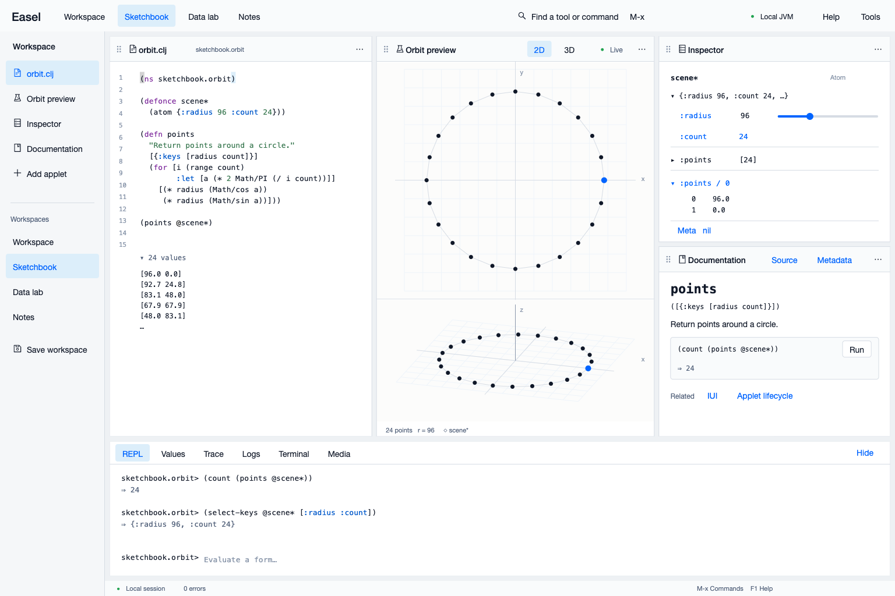
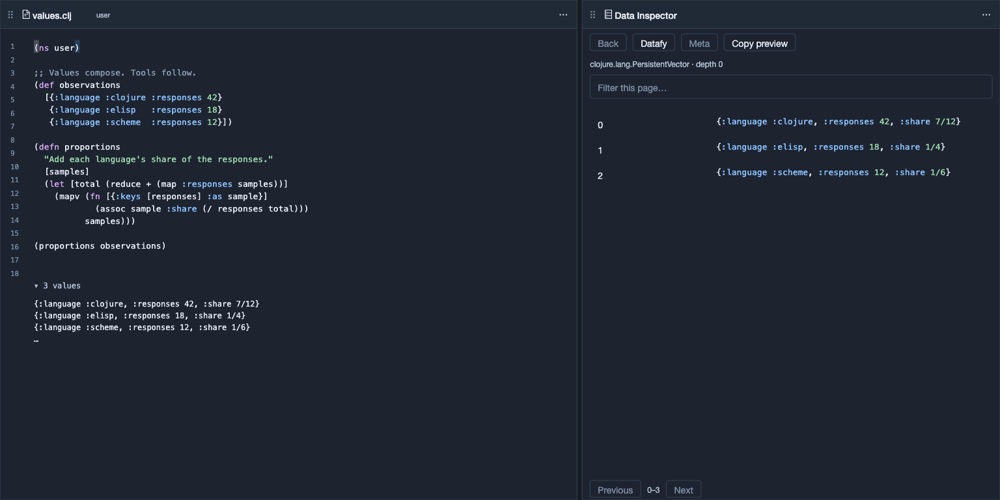
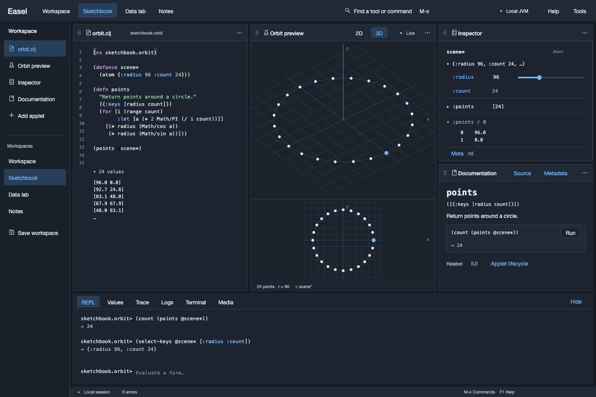
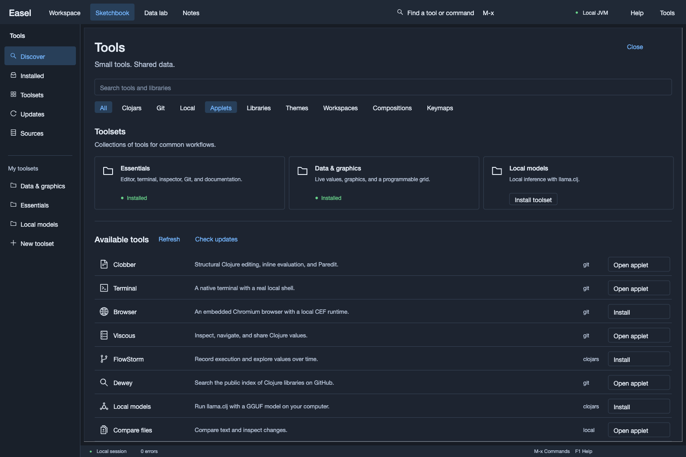
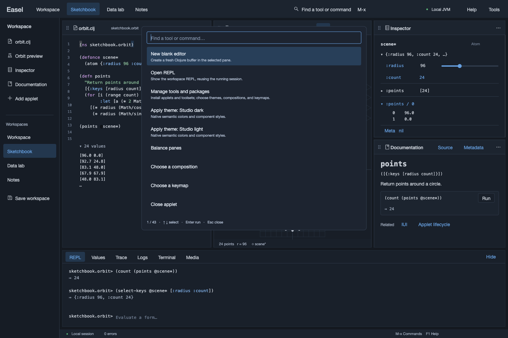

**Easel** - A Pure Clojure IDE in the Spirit of Emacs

Status: Alpha. Incomplete. Missing features.

### Screenshots

Easel starts with an empty Minimal workspace. These native captures show optional tools and workspaces; themes, compositions, and keymaps are EDN data.

| Studio · light | Studio · dark |
| --- | --- |
|  |  |

Minimal: an editor and an inspector.

Sketchbook: rotating the interactive 3D camera over the same live values. Click for a still frame.

Tools and commands

Install tools and toolsets, or choose themes, workspaces, and compositions.

Find actions with `M-x`.

### Differences from emacs

- clojure instead of elisp
- "everything is data" instead of "everything is text"
- modern graphics

#### Videos

- [Overview](https://youtu.be/hpjJJqnkqCw)
- [7gui demo](https://youtu.be/_WDwqka0s_8)
- [Instarepl demo](https://youtu.be/ac_ydoqPPWQ?si=qy9VKNekQ4-3bZNn)
- [Easel Turns One!](https://youtu.be/sceGtaNHxcM?si=hfXorgVxu2BGeui2)

### Goals

- IDE as a library
- Integrate anything: web, 2d graphics, 3d graphics, video, plots, widgets, games, terminal, data inspectors, debuggers, etc
- Make tools available à la carte
- Small, composable widgets
- Drag and drop UI editor
- First class support for repl driven development

### Non-goals

- Backwards compatibility with emacs
- Use web technologies for UI
- Run inside a web browser

### Resources

#### Slack

- #easel on Clojurians Slack ([invite here](http://clojurians.net/))

### "Roadmap"

- [X] Pure clojure code/text editor (see [clobber](https://github.com/phronmophobic/clobber))
- [ ] Polish: bug fixes, stability improvements, creature comforts
- [X] Data viewer improvements (ie. improve [viscous](https://github.com/phronmophobic/viscous))
- [X] Git integration
- [X] Diff viewers
- [X] Improve Tap viewer
- [X] Logging View
- [X] Exception stacktrace viewer
- [X] Flowstorm integration
- [X] Improved Pane management

### License

Easel is licensed under Apache License v2.0.
